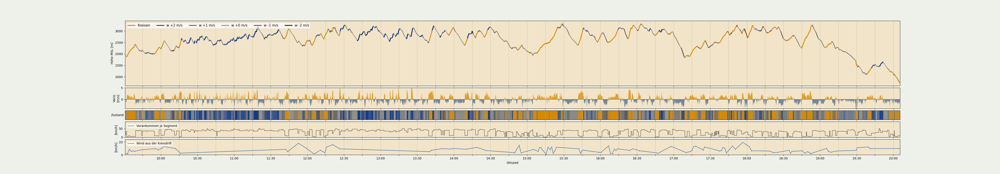

# flightstates — flight track in, one line of text out

Reads IGC tracks. Writes one text line per flight: the flight as a sequence
of segments. Two kinds, everything else is a number:

| Code | Segment | carries |
|---|---|---|
| `K` | circling | turn count, drift = **the wind** (one piece per ~4 turns, so the wind profile through the climb) |
| `G` | straight | `w` = **vertical movement of the air** (m/s, own sink removed), airspeed, path, and the wind that was subtracted |

The unit is the second, not the thermal: the air that carries a pilot
*without* circling is in the data. No classes; maps colour from `w`.

Version 2.3 (October 2026). Needs `numpy`, `pandas`, `scipy`. No maps, no
weather, no network. The Valais flow field and the Valais polars (Korner
2026) were built from this output.

## The run

```bash
pip install numpy pandas scipy

python3 flightstates.py --delta --id name --hist hist.npz "flights/**/*.IGC" > states.txt
```

`flights` is the folder with the IGC files; `**` searches all subfolders;
keep the quotes. Two things come out — **if you run this for someone else,
send exactly these:**

| | |
|---|---|
| `states.txt` | one line per flight — the segments |
| `hist_000.npz`, `hist_001.npz`, … | per flight one count table (vario × airspeed, 1-km/h bands), the raw material of the sink polars; 20 000 flights per file |

Nothing else. The IGC files stay where they are. No pilot names anywhere;
the glider type is the only thing taken from the IGC header. The count
tables hold no positions and no interpretation.

Big archive: run parts in parallel, each with its own histogram file.
About 35 ms per flying hour per core; a world archive of ~950 000 flights
is about one core-day and 2 GB compressed.

```bash
for k in 1 2 3 4; do
  python3 flightstates.py --delta --id name --part=$k/4 --hist hist$k.npz "flights/**/*.IGC" > part$k.txt &
done
wait; cat part*.txt | xz -6 > states.txt.xz
```

## The output line

```
# flightstates 2.3 polars=polars.csv sha1=2df03cffd1ef      <- file header, once
id;glider;pol;yyyymmdd;SEG|SEG|...;END

G (straight):   G,t,h,lat,lon,w,v,z,wind_kmh,wind_from_deg
K (circling):   K,t,h,lat,lon,turns,drift_kmh,drift_from_deg
END:              t,h,lat,lon
```

`t,h,lat,lon`: second of day UTC, altitude MSL and position where the
segment **begins**; the end of one segment is the beginning of the next.
`w`: vertical air movement, m/s, own sink removed. `v`: true airspeed km/h.
`z`: flown path over chord, %. `wind_kmh, wind_from_deg`: the wind that was
subtracted. `--delta` writes each number as difference to the previous;
`read_line()` / `read_line_delta()` in `flightstates.py` read both forms.

The line is corrected, but invertible: `w` uses the own sink from the
`polars.csv` beside the script (an example table; `--polars FILE` for
another) and the wind from the circling drift, but every straight segment
also carries its raw height difference, duration, chord and path and the
wind that was subtracted — so `w` and `v` can be recomputed with any better
polar or wind, without the tracks. The polars themselves come from the
count tables: the most frequent vario per airspeed band over all flights of
a glider type is its sink at that airspeed (method and checks: Korner 2026).

## How it decides

Per second: circling if the heading changes by more than 60° within 20 s
(94.7 % agreement with hand-marked flights). Wind from the circling drift
(≥ 1.5 turns, ≥ 30 s, ≤ 40 km/h). Straight stretches are cut where the
air-corrected height or the ground plan bends (Douglas-Peucker, 30 m height,
60 m position). Pure geometry, no labels. All thresholds are constants at
the top of `flightstates.py`.

## Check

```bash
python3 verify.py flight.IGC --out check.png     # the flight from the IGC and from the line alone, with errors
python3 chart.py  flight.IGC --out plate.png     # one flight as a plate
```



## Files

| | |
|---|---|
| `flightstates.py` | the segmenter, self-contained |
| `verify.py`, `chart.py` | check picture, day plate |
| `polarmaker.py` | optional, older: measures a polar table from an archive in 5-km/h bands, for `--polars`; not needed for the run above |
| `polars.csv`, `polars_stat.csv`, `polars.npz` | example polar table of one archive (1628 flights); the Valais polars of 101 types are in Korner (2026), not here |
| `example_line.txt`, `example_line_delta.txt`, `example_day.png`, `example_verify.png` | one flight as a line, both forms, and its pictures |

Barometric height when plausible, else GPS; times UTC; flights without
valid B records are skipped and reported on stderr.

Jörg Korner, 2026. Free to use.
